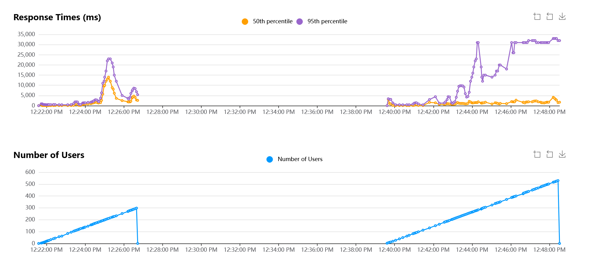
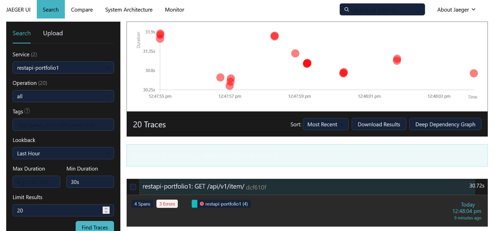

# Restapi-Portfolio1

A FastAPI REST API portfolio project with API key header authentication.

## Technologies

- FastAPI with API key header authentication
- SQLAlchemy + PostgreSQL
- Alembic migrations
- Redis
- Docker Compose + Caddy (reverse proxy)

## How to run

Make sure you have Docker and Docker Compose installed.

```
git clone https://github.com/floppy-disk916/restapi-portfolio1.git
cd restapi-portfolio1
cp .env.example .env

docker compose up --build --detach
```

## Performance


It has been tested with locust and viewed with Jaeger (The Jaeger setup is from deepseek AI)

The latest test: 11/28/2026

Environment:
connection pool size: 20


### Description:

P95 highest spike is between 30s to 35
while its P50 highest spike is between 0s to 5s
when the number of users is 394



with the bottleneck at GET request method



with the problem of QueuePool exhaustion


