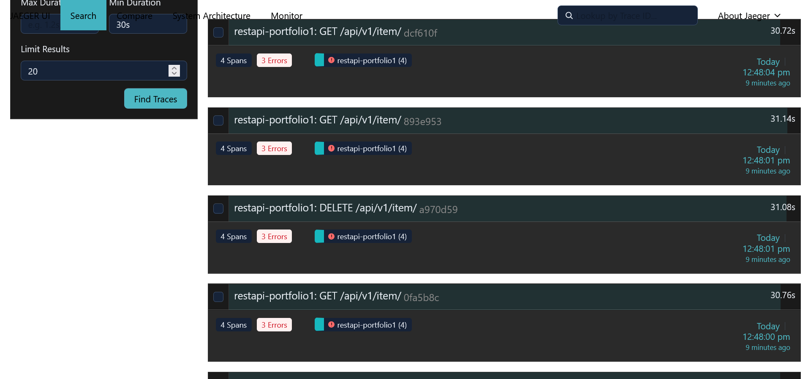
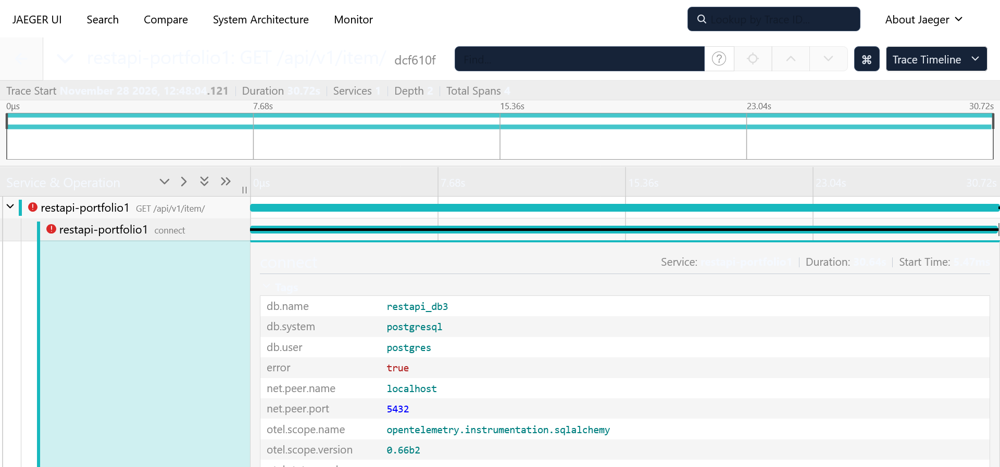
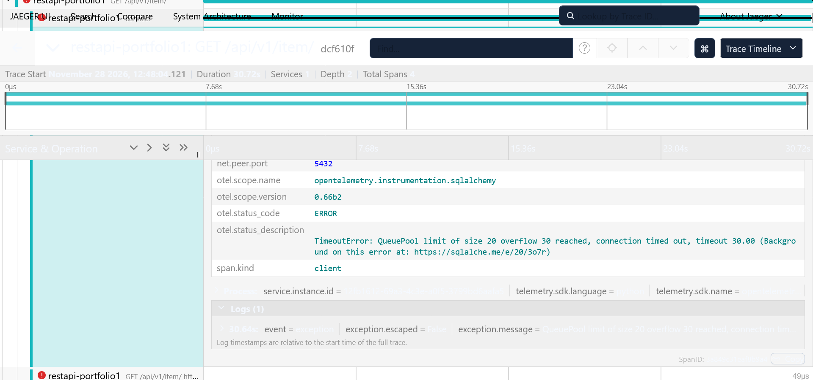

# Restapi-Portfolio1

A FastAPI REST API portfolio project with API key header authentication,
made mostly by hand with DeepSeek AI helps

Manages warehouse items and staff records, Auth via JWT for browser clients at
/auth/login and API Key by
admin account registration for m2m connection

## Technologies

- DeepSeek AI as secondary and reviewer
- FastAPI with API key header authentication
- SQLAlchemy + PostgreSQL
- Alembic migrations
- Docker Compose + Caddy
- SlowAPI with Redis as rate limiter
- Locust load testing framework
- Jaeger in docker container

## How to run

Make sure you have Docker and Docker Compose installed.

```
git clone https://github.com/floppy-disk916/restapi-portfolio1.git
cd restapi-portfolio1
cp .env.example .env

docker compose up --build --detach
```

## Performance


It has been tested with locust and viewed with Jaeger (by AI)

The latest test: 11/28/2026

Environment:\
Connection pool size: 20\
Maximum overflow: 30\
Total pool: 50

Connection age: 3600s

### Description:

P95 highest spike is between 30s to 35s
while its P50 highest spike is between 0s to 5s,
starting at 394 users


with the bottleneck at GET request method, at "connect" span which shows the longest bar




with the problem of QueuePool exhaustion




## Known Limitations
1. No pagination endpoint
2. Some migrations and git commits are either not atomic or not clear
3. No row-level security
4. Auth is per endpoint
